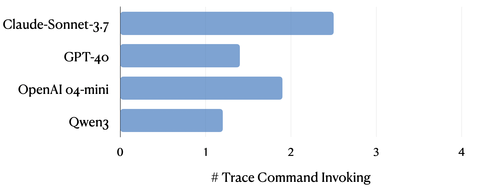

# Rust-SWE-bench: Evaluating and Improving Automated Repository-Level Rust Issue Resolution with LLM-based Agents

[](https://arxiv.org/)
[](https://huggingface.co/datasets/user2f86/rustbench)
[]()
[]()
[]()

This repository contains the official dataset, evaluation harness, agent frameworks, baselines, and reproduction suites for the paper:
> **Evaluating and Improving Automated Repository-Level Rust Issue Resolution with LLM-based Agents**  
> *Jiahong Xiang, Wenxiao He, Xihua Wang, Hongliang Tian, Yuqun Zhang*

---

## 📑 Table of Contents
- [Overview](#-overview)
- [Repository Structure](#-repository-structure)
- [API & Environment Configuration](#-api--environment-configuration)
- [Rust-bench Evaluation Harness](#-rust-bench-evaluation-harness)
  - [System Requirements](#system-requirements)
  - [Installation](#installation)
  - [Building Benchmark Docker Images](#building-benchmark-docker-images)
  - [Evaluating Model Predictions](#evaluating-model-predictions)
  - [Benchmark Construction & Curation](#benchmark-construction--curation)
- [RustForger: Dynamic Tracing Agent](#-rustforger-dynamic-tracing-agent)
  - [Key Architecture & Features](#key-architecture--features)
  - [Building `rustforger-tracer`](#building-rustforger-tracer)
  - [Running RustForger](#running-rustforger)
  - [Extracting Patches](#extracting-patches)
  - [Repair Records & Traces](#repair-records--traces)
- [Baseline Agents](#-baseline-agents)
  - [SWE-agent](#swe-agent)
  - [Normal Baseline (LangChain ReAct)](#normal-baseline-langchain-react)
  - [Test Baseline](#test-baseline)
- [Jifang Development Validation Set](#jifang-development-validation-set)
- [Reproduction Suites](#-reproduction-suites)
  - [1. Trajectory Replay (`reproduce/reproduction-replay`)](#1-trajectory-replay-reproducereproduction-replay)
  - [2. ACR & Agentless Reproduction (`reproduce/acr-agentless-reproduce`)](#2-acr--agentless-reproduction-reproduceacr-agentless-reproduce)
- [Study Materials & Evaluation Artifacts](#-study-materials--evaluation-artifacts)
- [Citation](#-citation)

---

## 📖 Overview

The Rust programming language enforces strict static semantics (ownership, borrowing, lifetimes, and complex trait systems), creating significant challenges for automated software engineering agents. 

To bridge the gap between LLM agents and the Rust ecosystem, this project provides:

1. **Rust-SWE-bench**: The first large-scale, repository-level benchmark dedicated to real-world Rust software engineering. It contains **500 carefully vetted, repository-level tasks** curated from **34 popular and diverse Rust crates** (available on Hugging Face at [`user2f86/rustbench`](https://huggingface.co/datasets/user2f86/rustbench)).
2. **Comprehensive Empirical Study**: Evaluation of leading agent architectures (SWE-agent, OpenHands, Agentless, AutoCodeRover) paired with state-of-the-art LLMs (Claude-3.7-Sonnet, GPT-4o, OpenAI o4-mini, Qwen3).
3. **RustForger**: A novel agentic repair framework specifically designed for Rust. It features an isolated testing environment, AST-based macro instrumentation (`syn` / `quote`), concurrent call-stack tracking, and dynamic execution tracing via `trace_cli`. RustForger achieves a **28.6% issue resolution rate** with Claude-3.7-Sonnet on Rust-SWE-bench, outperforming existing baselines by 34.9%.

---

## 📂 Repository Structure

```text
Rust-SWE-Bench/
├── data/                        # Shared canonical datasets (neutral center)
│   ├── rustbench-all.jsonl      # 500 benchmark tasks & metadata
│   └── rb_all_bug_report.json   # Bug reports (624 entries)
│
├── Rust-bench/                  # Core evaluation harness (forked from SWE-bench for Rust)
│   ├── swebench/
│   │   ├── harness/             # Docker build, test execution, and grading harness
│   │   ├── versioning/          # Task environment & commit versioning
│   │   └── collect/             # Issue and task collection utilities
│   └── setup.py                 # Installs the `swebench` python package
│
├── agents/                      # All evaluated & developed agent systems as equal peers
│   ├── shared/                  # Deduplicated shared modules (trace, symbols, error hints, candidates)
│   ├── normal/                  # Generic LangChain ReAct baseline
│   ├── ACI-impr/                # Rust ACI single-agent baseline
│   ├── graph/                   # LangGraph StateGraph multi-agent workflow
│   ├── graph-2/                 # Graph + lightweight pure-Rust RAII tracing & in-module tests
│   ├── CKG/                     # Graph + compiler-precise rustdoc JSON definition graph
│   ├── test/                    # Full Rust multi-agent repair system (Graph + CKG + Tracing)
│   ├── rustforger/              # ICSE'26 RustForger dynamic tracing agent & `rustforger-tracer`
│   ├── swe_agent/               # SWE-agent adapted for Rust projects
│   └── acr_agentless/           # AutoCodeRover & Agentless prompt-driven workflows
│
├── suites/                      # Frozen benchmark suites & shared execution orchestrator
│   ├── common/                  # Shared runner (`runner.py`) & Cargo offline cache (`cache_cargo.py`)
│   ├── testset/                 # 50-task balanced test set (`manifest.json`, `testbench`)
│   └── experimentset/           # 100-task experiment set (`manifest.json`, `experimentbench`)
│
├── reproduce/                   # Trajectory replay suite (`reproduction-replay`)
├── analysis/                    # Saved experimental summaries & analysis scripts
├── material/                    # Experimental data, manual review sheets, and sample logs
├── figures/                     # Publication figures & plotting scripts
├── pyproject.toml               # Root project anchor & pytest configuration
├── .env.example                 # Environment variables template
└── .env                         # Local API credentials & model settings (keep private)
```

---

## ⚙️ API & Environment Configuration

Copy `.env.example` to `.env` in the repository root and set your API keys:

```bash
cp .env.example .env
```

Configure the following fields:

```dotenv
BASE_URL=https://api.openai.com/v1
API_KEY=your_api_key_here
MODEL=claude-3-7-sonnet-20250219
GITHUB_TOKEN=your_github_token_here
API_LIMIT=70
```

- **`BASE_URL`**: OpenAI-compatible API endpoint URL (supports official OpenAI, Anthropic via proxy, Azure, Ollama, etc.).
- **`API_KEY`**: Your model API key.
- **`MODEL`**: Target model identifier (e.g., `claude-3-7-sonnet-20250219`, `gpt-4o-2024-05-13`, `o4-mini`).
- **`GITHUB_TOKEN`**: Personal access token used for cloning repositories and fetching metadata.
- **`API_LIMIT`**: Positive integer setting the maximum model HTTP requests allowed per repair attempt (defaults to `70`).

*Note: Environment variables exported in your current shell take precedence over `.env`.*

---

## 🚀 Rust-bench Evaluation Harness

`Rust-bench` is the execution and evaluation framework adapted from SWE-bench to support cargo workspaces, Rust toolchain versioning, and containerized compilation.

### System Requirements

Running benchmark evaluations involves compiling diverse Rust codebases inside Docker containers. Recommended specs:
- **OS:** Linux (Ubuntu 20.04+ recommended) or WSL2 on Windows, x86_64 architecture.
- **Docker:** Docker Engine with active daemon.
- **CPU:** 8 cores or more (configure `--max_workers <= min(0.75 * os.cpu_count(), 24)`).
- **RAM:** 16GB or more.
- **Storage:** At least 120GB free space for caching base and instance Docker images.

### Installation

```bash
# Navigate to Rust-bench directory
cd Rust-bench

# Install swebench in editable mode
pip install -e .
```

### Building Benchmark Docker Images

Pre-build instance images using the official dataset (`user2f86/rustbench` on Hugging Face):

```bash
# Run from within the Rust-bench directory
python -m swebench.harness.run_evaluation     --dataset_name user2f86/rustbench     --run_id rustbench_prebuild     --max_workers 8     --cache_level instance     --predictions_path gold     --split train     --config_path swebench/harness/logs/config.json     --build_image_only 1
```

### Evaluating Model Predictions

To evaluate candidate patches generated by any model or agent:

```bash
# Run from within the Rust-bench directory
python -m swebench.harness.run_evaluation     --dataset_name user2f86/rustbench     --predictions_path <path_to_predictions.jsonl>     --max_workers 8     --run_id <your_run_id>     --config_path swebench/harness/logs/config.json     --build_image_only 0
```

- **Predictions format:** A JSONL file where each record contains:
  ```json
  {"instance_id": "tokio-rs__bytes-253", "model_patch": "diff --git ...", "model_name_or_path": "rustforger"}
  ```
- **Outputs:**
  - Build logs: `logs/build_images/`
  - Per-instance reports: `logs/run_evaluation/<run_id>/<model>/<instance_id>/report.json`
  - Run summary: Saved under `eval_reports/` or `reports/`.

### Benchmark Construction & Curation

The 500 tasks in `user2f86/rustbench` were filtered from `user2f86/raw_dataset` through a 3-pillar quality control protocol:
1. **Solution Leakage:** Ensuring no direct or indirect exposure of the solution in the issue description.
2. **Problem Description Clarity:** Verifying the problem statement is unambiguous and reproducible.
3. **Test Validity:** Validating that test cases accurately fail before the patch and pass after it.

Each task is classified in `material/instances.xlsx` as **Selected** (500 benchmark instances), **Candidate**, or **Rejected**.

#### Dataset Construction Commands (from `Rust-bench/`)
```bash
# 1. Fetch version and task instances
python -m swebench.versioning.get_versions     --instances_path <repo>-task-instances.jsonl     --retrieval_method github     --num_workers 8     --output_dir <output_dir>     --cleanup

# 2. Update environment setup commits
python -m swebench.versioning.environment_setup_commit     --dataset_name repo_versions.json     --output_dir <output_dir>

# 3. Validate gold patches on prepared tasks
python -m swebench.harness.run_validation     --dataset repo_versions.json     --run_id repo_gold     --max_workers 8     --cache_level instance     --output_dir <output_dir>
```

---

## 🦀 RustForger: Dynamic Tracing Agent

RustForger is designed to address the specific challenges of resolving Rust repository issues: whole-repo comprehension, complex lifetime/type errors, and test reproduction.


*Figure: Average dynamic trace invocations per task across leading LLMs.*

### Key Architecture & Features

1. **AST-based Macro Instrumentation (`rustforger-tracer`):**
   - Built with `syn` and `quote`, inserting lightweight entry/exit hooks directly into target functions.
   - Automatically excludes closures, macros, and existing test functions to minimize overhead.
   - Preserves thread-local call stacks with `serde_json` serialization.
2. **Panic-Safe Execution:**
   - Tracing data is safely flushed and preserved even if the instrumented code panics during test execution (see example in `material/RustAgent_clap-rs__clap-2587.traj`).
3. **Automated Backup & Rollback:**
   - Automatically generates `.rs.bak` snapshots and reverts all changes during cleanup, preventing source corruption.
4. **Intelligent Error Recovery:**
   - Uses Levenshtein distance matching to suggest candidate function names if target symbols are misspelled.
5. **Agent API (`RustForger/src/agent_api.py`):**
   - `api_execute_bash`: Executes arbitrary terminal commands in the container.
   - `api_str_replace` & `api_new_file`: Accurate file reading and editing tools.
   - `api_trace`: Invokes `trace_cli run-flow` to inspect runtime values and execution paths.
   - `api_test_report`: Records reproduction status and results.
   - `api_task_report`: Gathers final modified files and unified diffs.

### Building `rustforger-tracer`

Before running RustForger, compile the `trace_cli` binary:

```bash
cd RustForger/rustforger-tracer
cargo build --release

# Place the binary in bin/ for the container runner
mkdir -p bin
cp target/release/trace_cli bin/
```

### Running RustForger

```bash
# 1. Create and activate a Python 3.11 environment
conda create -n rustforger python=3.11 -y
conda activate rustforger

# 2. Install dependencies
pip install langchain langchain-openai openai langchain_community loguru docker python-dotenv

# 3. Execute RustForger via the Docker handler
cd RustForger
python src/docker_handler.py
```

*Tip: You can customize target instances in `RustForger/src/docker_handler.py` by modifying `load_instances()`.*

### Extracting Patches

After runs finish, convert the per-instance JSON logs into a unified prediction JSONL file:

```bash
# Run from RustForger/
python src/patch_extracter.py ./log ./log/rustforger_predictions.jsonl
```

The resulting `rustforger_predictions.jsonl` can be evaluated directly with the `Rust-bench` harness.

### Repair Records & Traces

- **RustForger:** Logs are saved in `RustForger/log/rustforger_log_<instance_id>.json` and `RustForger/log/runs/<run_id>/trace.jsonl`.
- **normal / test baselines:** Traces are saved in `traces/<run_id>.jsonl` beside the prediction file, or in `--trace-dir`.
- **SWE-agent:** Trajectories are stored in `trajectories/<user>/<run-name>/attempts/<instance_id>/`.

---

## 🤖 Baseline Agents

The baselines use the global `.env` configuration.

### SWE-agent

We adapted [SWE-agent](https://github.com/princeton-nlp/SWE-agent) to interface with the Rust evaluation environment:

```bash
cd baselines/SWE-agent
conda env create -f environment.yml
conda activate swe-agent

# Run single instance or batch evaluation
python3 run.py    --model_name configured    --cache_task_images True    --pre_build_all_images False    --remove_image False    --pr_file data/rust_bench_500.jsonl    --config_file config/default.yaml    --skip_existing True    --print_config False    --max_workers_build_image 4
```

### Normal Baseline (LangChain ReAct)

A Rust-specialized LangChain ReAct agent equipped with cargo commands, compiler diagnostic classification, and Red-Green paired reproduction verification.

```bash
# Install dependencies
pip install -r baselines/normal/requirements.txt

# Run repair on an instance
python baselines/normal/agent.py     --repo /path/to/target_checkout     --instance-id owner__repo-123     --issue-file /path/to/issue.txt     --dataset /path/to/tasks.jsonl     --output patch/normal.jsonl
```
*See [baselines/normal/README.md](baselines/normal/README.md) for full options and tool documentation.*

### Test Baseline

An extended variant of the normal baseline used for ongoing experimental optimizations and ablation studies.
*See [baselines/test/README.md](baselines/test/README.md) for details.*

---

## Jifang Development Validation Set

The fixed [10-task validation set](validation/manifest.json) supports repeated agent development on the Jifang server. It was selected from the 110 locally cached task images with three large, four medium, and three small reference patches. Patch size is the number of added plus deleted lines: small ≤15, medium 16–150, and large >150. These thresholds are operational choices based on scales used in the paper, not a formal difficulty classification. Selection uses a fixed seed, favors distinct repositories, and excludes tasks with evaluation reports found at selection time; the latter does not prove the remaining tasks were never run.

Run the following commands **on Jifang**. The entry point depends on the existing `~/xpc` layout, rootful Docker, the task images, `~/xpc/.env`, and the Windows proxy and SSH reverse tunnel on port `11321`. Check that the Windows proxy is listening and the tunnel is reachable before evaluation.

```bash
# Inspect the fixed tasks or check prerequisites without calling a model
~/xpc/validation/validate --agent all --list
~/xpc/validation/validate --agent all --dry-run

# Generate patches and evaluate all registered agents
~/xpc/validation/validate --agent normal
~/xpc/validation/validate --background --agent all

# Restrict a run to one task; --instance may be repeated
~/xpc/validation/validate --agent test --instance chronotope__chrono-991
```

`--agent` accepts `swe-agent`, `RustForger`, `normal`, `ACI-impr`, `test`, `stage`, `graph`, or `all`. Runs default to background execution with direct network access; pass `--foreground` to run interactively, or `--network proxy` to route through the local SSH proxy tunnel. Use `--max-workers` and `--timeout` to control evaluation concurrency and the per-task test timeout. Runs call the configured model and can incur API costs.

Results are written under `~/xpc/validation/runs/<run_id>/`, including predictions, agent logs, source and image metadata, and `summary.json`. The summary distinguishes resolved, unresolved, no-patch, agent-error, and evaluation-error outcomes. Per-instance harness reports and test output are under `~/xpc/Rust-bench/logs/run_evaluation/`. Updates made in the Windows workspace must first be synchronized to the corresponding server-side agent directories; this runner does not synchronize source code automatically.

See [validation/README.md](validation/README.md) for all commands, exact selection rules, and result paths. Because this set is repeatedly used to guide development, reserve a separate test set for final independent evaluation.

---

## 🔄 Reproduction Suites

### 1. Trajectory Replay (`reproduce/reproduction-replay`)

Replays execution trajectories recorded by SWE-agent or other agents inside Docker containers to capture command stdout, stderr, and return codes:

```bash
# 1. Environment setup
conda create -n replay python=3.12 -y
conda activate replay
cd reproduce/reproduction-replay
cd replay/dependencies/SWE-agent && pip install -r requirements.txt && cd ../..
pip install -r requirements.txt

# 2. Run replay script
bash replay.sh

# Or invoke directly with custom commands:
python -m replay.run     --instance-id ast-grep__ast-grep-1707     --instance-method SWE-agent     --instance-model claude     --instance-traj-path data/SWE-agent/claude/ast-grep__ast-grep-1707.traj     --save-dir result     --command "cargo test"
```
*Outputs are saved under `<save-dir>/<method>/<model>/<instance-id>/`.*

### 2. ACR & Agentless Reproduction (`reproduce/acr-agentless-reproduce`)

Reproduces AutoCodeRover and Agentless workflows on Rust-SWE-bench instances:

```bash
cd reproduce/acr-agentless-reproduce

# Run reproduction for a specific instance
python src/rta_main.py     --model gpt-4o-2024-08-06     --instance clap-rs__clap-2587
```

Outputs and conversation histories are recorded under `reproduce/acr-agentless-reproduce/log/`.

---

## 📊 Study Materials & Evaluation Artifacts

All experimental annotations and qualitative study data are organized in the `material/` directory:

- **`material/instances.xlsx`**: Full audit of the 500 benchmark instances across solution leakage, description clarity, and test integrity.
- **`material/rustforger_correct_patch.xlsx`**: Detailed manual equivalence analysis of candidate patches generated by RustForger against gold developer patches.
- **`material/openhands_correct_patch.xlsx`**: Manual correctness and equivalence analysis for OpenHands patches.
- **`material/classified_rust_issues.jsonl`**: Fine-grained categorization of Rust issues (borrow checker, lifetime, trait resolution, panic handling, etc.).
- **`material/*.traj` & `*.log`**: Complete execution traces from representative repair sessions (e.g. `clap-rs__clap-2587`, `bevyengine__bevy-10627`).
- **`eval_reports/`**: Destination directory for summary reports generated by the evaluation harness.

---

## 📚 Citation

If you find Rust-SWE-bench or RustForger helpful in your research, please cite our paper:

```bibtex
@article{xiang2025rustswebench,
  title={Evaluating and Improving Automated Repository-Level Rust Issue Resolution with LLM-based Agents},
  author={Xiang, Jiahong and He, Wenxiao and Wang, Xihua and Tian, Hongliang and Zhang, Yuqun},
  journal={arXiv preprint},
  year={2025}
}
```
