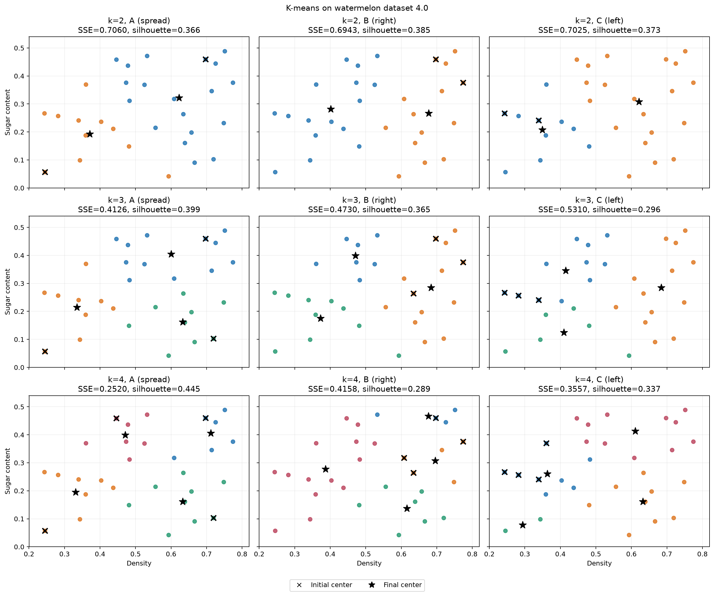

# 西瓜数据集 4.0 上的 k 均值聚类实验

## 1. 实验设置

使用题图中的 30 个样本，每个样本包含密度和含糖率两个特征，采用原始数值和欧氏距离，不做标准化。分别取 `k=2、3、4`。对每个 `k`，设置三组初始中心；初始中心均直接取自数据集，表中编号与题图对应。

| 初始化方案 | k=2 | k=3 | k=4 | 特点 |
| --- | --- | --- | --- | --- |
| A | 1、11 | 1、11、17 | 1、11、17、30 | 相对分散，覆盖不同区域 |
| B | 1、2 | 1、2、3 | 1、2、3、4 | 集中在数据分布的右侧 |
| C | 10、19 | 10、19、20 | 10、19、20、15 | 集中在数据分布的左侧 |

## 2. 算法与评价指标

程序实现了 Lloyd 迭代：先将每个样本分配给最近的中心，再用每个簇的样本均值更新中心，直到样本所属簇不再变化。若出现空簇，则将已有簇中距离其中心最远、且所在簇还有其他样本的点移入空簇，然后重新计算中心。程序设置了最大迭代次数；未收敛时会报错。

使用两个评价指标：

- **簇内平方误差 SSE**：所有样本到其所属簇中心的欧氏距离平方之和。同一个 `k` 下，SSE 越小，簇内通常越紧凑。
- **平均轮廓系数**：对每个样本计算 `(b-a)/max(a,b)`，其中 `a` 是到同簇其他样本的平均欧氏距离，`b` 是到其他各簇的平均欧氏距离中的最小值。单样本簇的轮廓系数记为 0。该指标通常越大表示簇内更紧凑、簇间更分离，可辅助比较不同的 `k`。

## 3. 实验结果

数值由 `kmeans.py` 计算，迭代次数包括确认分类不再变化的最后一次分配和更新。

| k | 方案 | 初始中心编号 | SSE | 平均轮廓系数 | 迭代次数 |
| --- | --- | --- | ---: | ---: | ---: |
| 2 | A | 1、11 | 0.706007 | 0.365902 | 2 |
| 2 | B | 1、2 | **0.694340** | **0.385476** | 3 |
| 2 | C | 10、19 | 0.702482 | 0.372821 | 4 |
| 3 | A | 1、11、17 | **0.412567** | **0.398592** | 2 |
| 3 | B | 1、2、3 | 0.472964 | 0.365313 | 6 |
| 3 | C | 10、19、20 | 0.530953 | 0.296448 | 6 |
| 4 | A | 1、11、17、30 | **0.252016** | **0.445071** | 3 |
| 4 | B | 1、2、3、4 | 0.415786 | 0.289363 | 4 |
| 4 | C | 10、19、20、15 | 0.355654 | 0.337340 | 5 |

各簇的颜色表示其最终归属，黑色叉号表示初始中心，黑色五角星表示最终中心：



例如，`k=4`、方案 A 的最终聚类如下，坐标顺序为（密度，含糖率）：

| 簇 | 最终中心 | 样本编号 |
| --- | --- | --- |
| C1 | (0.711500, 0.405667) | 1、2、4、22、26、29 |
| C2 | (0.331375, 0.194625) | 6、8、10、11、12、18、19、20 |
| C3 | (0.632556, 0.161667) | 3、5、7、9、13、14、16、17、21 |
| C4 | (0.471000, 0.399286) | 15、23、24、25、27、28、30 |

程序运行时还会输出其余各组的最终中心和全部样本归属。

## 4. 分析与结论

1. **初始中心会影响结果。** 相同 `k` 下，不同初始化产生的最终中心、样本归属和 SSE 不同，说明 k 均值可能收敛到不同的局部最优解。`k=4` 时，方案 A 的 SSE 为 0.252016，而方案 B 为 0.415786。
2. **覆盖不同数据区域的初始化往往有利，但并不保证最优。** 较分散的方案 A 在 `k=3、4` 时得到本实验中较低的 SSE，可能是因为初始中心较好地覆盖了不同区域，减少了多个中心聚集在同一区域的情况。但是 `k=2` 时，中心较近的方案 B 反而优于方案 A。因此不能断言初始中心距离越大结果就一定越好；也应避免将离群点当成有代表性的中心。实际应用中，可使用 k-means++ 初始化并进行多次独立运行，再在相同 `k` 下选取 SSE 最小的结果。
3. **不能只看 SSE 选择 `k`。** 随着簇数增加，理论上的最优 SSE 不会增大，不同初始化下的实际运行结果则不一定满足严格单调。九次实验中，`k=4`、方案 A 的平均轮廓系数最高（0.445071），因此它是本实验中值得优先考虑的一组结果；这不代表它是所有 `k` 和所有初始化中的全局最佳方案。
4. 数据中没有类别真值，本实验不能计算聚类准确率；结果反映的是密度和含糖率空间中的分组。

## 5. 运行方法

进入本目录后执行：

```bash
python kmeans.py
```

计算过程只依赖 Python 标准库。如需重新生成对比图，需安装 matplotlib，然后执行：

```bash
python kmeans.py --plot
```

图片将保存到脚本所在目录的 `watermelon_kmeans.png`。
